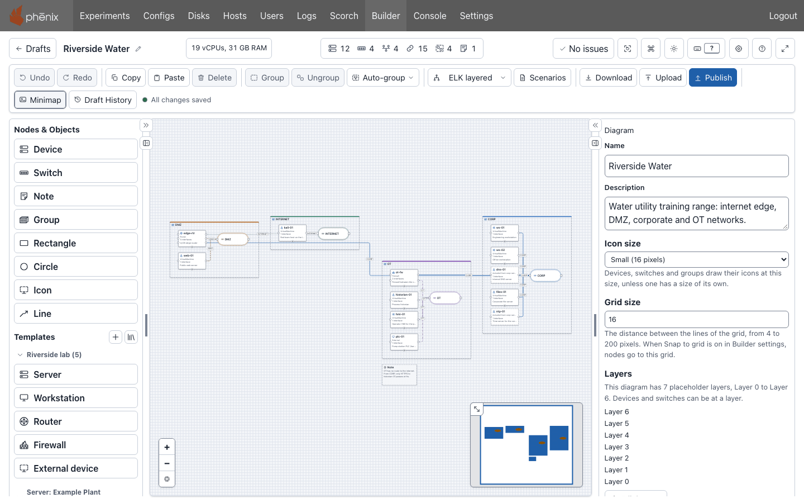
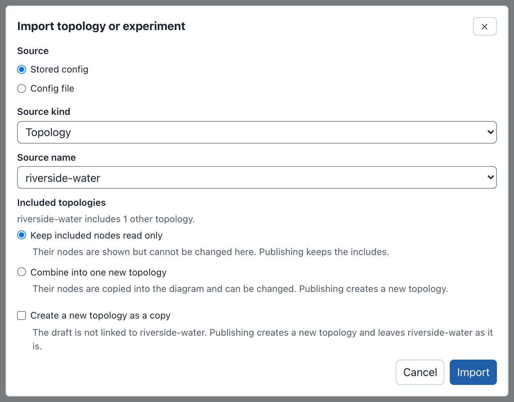
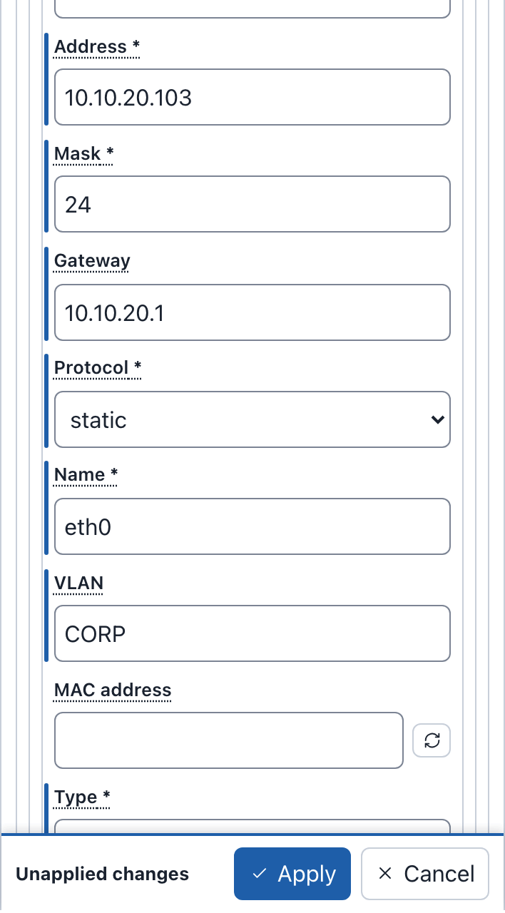
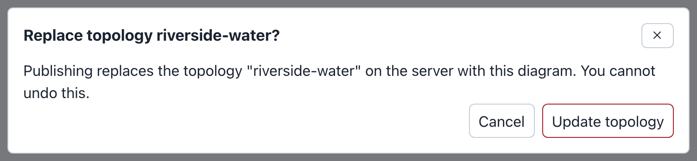
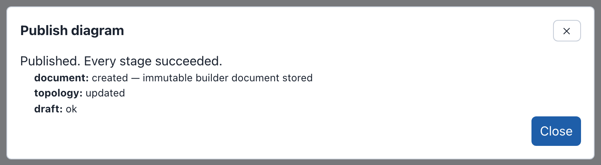

# Builder

Builder is an awesome tool for creating and editing topologies in a friendly, easy-to-use graphical interface. It can import and edit existing topologies, create new topologies, and validate configurations without publishing anything. Builder is *built*-in to phenix and can be accessed via the `Builder` tab in the phenix UI.

## What you can do with Builder

- [Draw](diagrams.md) devices, switches (one per network), connections,
  notes, groups and drawings, with your own colors, line styles and icons.
- Arrange nodes with one of five automatic layouts (in the image above, the "ELK layered" layout is used).
- Put nodes on your own [layers](diagrams.md#layers) and stack them with the **By layer** layout (e.g. Purdue model levels).
- Create a draft from an existing Topology or Experiment config with [**Import**](import-upload-download.md), or from
  a file with [**Upload**](import-upload-download.md).
- Create reusable [device templates](templates.md), stored in the diagram or the shared **Node Templates** library.
- View, edit, create or upload [Scenario configs](diagrams.md#scenarios) for your topology
- Restore earlier versions with **Draft History**. Builder
  automatically [saves each edit](drafts.md#how-drafts-save) to the server as you work.
- [Find problems](editor.md#checks-and-warnings) before you publish, such as
  an interface with no network or an invalid hostname.
- Keep a diagram as a [file next to its topology](administration.md#builder-documents-in-files)
  on the phenix server.
- Use the [command palette](editor.md#command-palette) and
  [keyboard shortcuts](editor.md#keyboard-shortcuts) to quickly find nodes, navigate, and make changes without touching the mouse (in fact, Builder is able to be used exclusively from the keyboard if you so desire!)
- Shared libraries of [layer sets](drafts.md#the-layers-tab), [custom icons](diagrams.md#custom-icons), [device templates](templates.md#the-template-library), and [drafts](drafts.md#the-drafts-page) can be used by anyone on the same phenix instance.
- [Download](import-upload-download.md#downloading) the diagram in whatever format you need:
    - Builder YAML or Topology YAML for import to another phenix instance.
    - PNG or SVG image for putting on a slide or report.
    - A [draw.io](https://www.drawio.com/) diagram.
    - A GEXF file for import into [Gephi](https://gephi.org/).

!!! note
    The current builder replaced the old builder phenix had for a long time. Those legacy builder XMLs can be auto-converted to the new format. See [Legacy Builder](legacy.md) for details.

## Quick start

First, [load the example configs](builder-examples.md).

### Import the topology

1. Select **Builder** in the navigation bar. This opens the Drafts page.
2. Click on **Import**.
3. In the **Import topology or experiment** dialog, select `riverside-water` under
   **Source name**. Keep everything else as-is. See the image below for reference.
4. Click on **Import**. The dialog says "This import has 1 warning." The
   warning says that `dns-01` and `ntp-01` come from the included topology
   `corp-services` and are read only.
5. Click on **Continue to editor**. A new draft named `riverside-water` opens,
   with its devices in rows on a grid.
6. In the toolbar, open the layout menu (**Default**) and choose
   **ELK layered**.

### Add a workstation

1. Under **Templates**, select **Workstation**. A device named workstation
   appears on the canvas, and the Inspector bar on the far right shows its default settings (these are populated based on the template and phenix defaults).
2. In the Inspector, set **Hostname** to `ws-03` and **Description** to
   `Engineering workstation`.
3. Under **Network**, select **Add interface**. The new interface has
   **Interface kind** **Static or OSPF**, **Name** `eth0` and **Mask** `24`.
4. Enter **Address** `10.10.20.103`, **Gateway** `10.10.20.1` and **VLAN**
   `CORP`.
5. Select **Apply**. Builder connects eth0 to the CORP switch because of the
   VLAN `CORP`. See the image below.
6. Make sure that the header shows **No issues**, 13 devices and 16
   connections, and the toolbar shows **All changes saved**.

{ width="354" }

### Publish the topology

1. Select **Publish** in the toolbar. The **Publish diagram** dialog opens.
2. Keep **Topology only** and **Topology name** `riverside-water`. The
   dialog says "A topology with this name exists. Publishing updates it."
   **Checks** says that 11 devices, 4 switches, 4 networks and 14
   connections are ready to publish. The topology includes `dns-01` and
   `ntp-01` by reference from `corp-services`.
3. Select **Update topology**. Builder asks "Replace topology
   riverside-water?". See the first image below.
4. Select **Update topology** again. The dialog says "Published. Every stage
   succeeded". See the second image below.
5. Select **Close**.

The Topology config `riverside-water` now has `ws-03`, and the tag `builder`
on the **Configs** page. The tag, the **Edit** button and **Open in
Builder** [open the quick start draft](publishing.md#editing-a-published-topology).
Experiments made from the topology before, such as `riverside`, keep their
copy of it. To run the new topology,
[create an experiment](../experiments.md#create-a-new-experiment) from it,
or [publish a topology and an experiment](publishing.md#publishing-a-topology-and-an-experiment).
