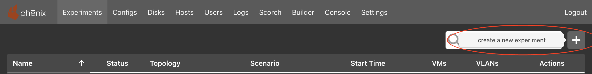

# Experiments

For experiments spanning multiple minimega hosts, see [GRE Mesh](gre-mesh.md)
to trunk experiment networks between hosts with `--use-gre-mesh`, including
the physical network MTU requirements.

## Listing Experiments

### From the Web-UI

Click on the `Experiments` tab. This will display all available experiments that
the user has access to view or edit.

### From the Command Line Binary

This will display a list of all available experiments: it is run as a `root`
user.

```bash
phenix exp list
```

<br>

## Starting / Stopping Experiments

### From the Web-UI

Clicking the `stopped` button will start the experiment; similarly the `started`
button will stop the experiment. A progress bar is used to update the progress
of starting an experiment. During the update to the experiment -- starting or
stopping -- it will not be accessible or available to delete.

### From the Command Line Binary

```bash
phenix exp start <experiment name>
```

Or ...

```bash
phenix exp stop <experiment name>
```

Or ...

```bash
phenix exp restart <experiment name>
```

Optionally, you can use the `--dry-run` flag to do everything except call out to
minimega.

After an experiment stops successfully, phēnix deletes the VM disk snapshots
created for file injection. To keep these snapshots for debugging, use
`--keep-injection-snapshots` or its `-K` shorthand:

```bash
phenix exp stop --keep-injection-snapshots <experiment name>
```

Only `phenix exp stop` accepts this option. Stopping an experiment from the
Web-UI, or with `phenix exp restart`, always deletes the snapshots. A start that
fails in minimega, unless `--treat-mm-errors-as-warnings` is given, runs the
cleanup apps, clears the experiment's minimega namespace and deletes the
snapshots it created too.

A stop first ends what still uses the experiment, such as its SCORCH runs,
which can take minutes. If another process stops the experiment, or stops and
starts it again, meanwhile, the stop leaves the stored run alone and fails
with `experiment <name>: experiment was stopped or started again while it was
stopping: stored start time "<time>", read "<time>"`, which gives the start
time stored now and the one the stop read; an empty one means stopped.

The `phenix exp --help` command will output:

```text
Experiment management

Usage:
  phenix experiment [flags]
  phenix experiment [command]

Aliases:
  experiment, exp

Available Commands:
  apps            List of available apps to assign an experiment
  create          Create an experiment
  delete          Delete an experiment
  edit            Edit an experiment
  list            Display a table of available experiments
  reconfigure     Reconfigure an experiment
  restart         Restart an experiment
  schedule        Schedule an experiment
  schedulers      List of available schedulers to assign an experiment
  scorch          Start a Scorch run for experiment
  start           Start an experiment
  stop            Stop an experiment
  trigger         Trigger lifecycle stage for app(s) in experiment

Flags:
  -h, --help   help for experiment

Use "phenix experiment [command] --help" for more information about a command.
```

!!! note
    For a list of global flags supported across all `phenix` subcommands, see [Global Flags](settings.md#global-flags).

## Create a New Experiment

### From the Web-UI

{: width=800 .center}

Click the `+` button to the right of the filter field.

{: width=400 .center}

Enter `Experiment Name` and `Experiment Topology`, the remaining selection are
optional. In this example, `bennu` is an example topology and is not included
by default. You will need to [create](configuration.md) your own topology(ies).

#### Purely via the Web-UI (Uploading Topo/Scenario Files)

You can create an experiment entirely through the Web-UI using custom topology and scenario files without needing to use the CLI:

1. **Upload Configurations in the Configs Tab**:
    * Navigate to the **Configs** tab.
    * Click the **Upload** button to upload your topology file (`.yaml`).
    * (Optional) Click **Upload** again to upload your scenario file (`.yaml`).
    * Verify that your uploaded configurations appear in the table (e.g., `topology/my-topology` and `scenario/my-scenario`).

2. **Create Experiment in Experiments Tab**:
    * Navigate to the **Experiments** tab.
    * Click the `+` button to open the creation dialog.
    * Enter an **Experiment Name**.
    * Select your uploaded topology from the **Experiment Topology** dropdown.
    * (Optional) Select your uploaded scenario from the **Experiment Scenario** dropdown.
    * Click **Save** to create the experiment.

### From the Command Line Binary

You can create an experiment using either saved configuration names from the phēnix store or direct file paths to topology and scenario configuration files (`.yaml`).

```bash
# Using stored configuration names
phenix experiment create <experiment name> -t <topology name>
phenix experiment create <experiment name> -t <topology name> -s <scenario name>

# Using direct file paths for topology and scenario
phenix experiment create <experiment name> -t /path/to/topology.yaml
phenix experiment create <experiment name> -t /path/to/topology.yaml -s /path/to/scenario.yaml

# Specifying a base directory and disabled apps
phenix experiment create <experiment name> -t /path/to/topology.yaml -s /path/to/scenario.yaml -d </path/to/dir/> --disabled-apps "app1,app2"
```

The `phenix exp create --help` command will output:

```text
Create an experiment

  Used to create an experiment from existing configurations; can be a
  topology, or topology and scenario, or paths to topology/scenario
  configuration files (YAML or JSON). (Optional are the arguments for
  scenario or base directory.)

  --vlan-min and --vlan-max set the experiment's VLAN range: minimega
  assigns its VLAN IDs from min up to, but not including, max. Set both, or
  neither to use minimega's default pool. While the experiment runs, minimega
  reserves the range and refuses to start another experiment whose range
  overlaps it.

Usage:
  phenix experiment create <experiment name> [flags]

Examples:

  phenix experiment create <experiment name> -t <topology name or /path/to/filename>
  phenix experiment create <experiment name> -t <topology name or /path/to/filename> -s <scenario name or /path/to/filename>
  phenix experiment create <experiment name> -t <topology name or /path/to/filename> -s <scenario name or /path/to/filename> -d </path/to/dir/>
  phenix experiment create <experiment name> -t <topology name or /path/to/filename> -s <scenario name or /path/to/filename> --disabled-apps "app1,app2"

Flags:
  -d, --base-dir string         Base directory to use for experiment (optional)
  -b, --default-bridge string   Default bridge name to use for experiment (optional) (default "phenix")
      --disabled-apps strings   Comma separated ist of apps to disable
  -h, --help                    help for create
  -s, --scenario string         Name of an existing scenario to use (optional)
  -t, --topology string         Name of an existing topology to use
      --vlan-max int            VLAN range max; minimega assigns VLAN IDs below it (2-4096); needs --vlan-min
      --vlan-min int            VLAN range min, the first VLAN ID minimega assigns (1-4095); needs --vlan-max
```

### VLAN Ranges

`--vlan-min` and `--vlan-max` give an experiment a VLAN range of its own.
minimega assigns the experiment's VLAN IDs from the min up to, but not
including, the max, so `--vlan-min 300 --vlan-max 310` gives VLAN IDs 300 to
309. Set both ends, or neither to take VLAN IDs from minimega's default pool
(its `-vlanrange` flag, VLAN IDs 101 to 4095 by default). The min is 1-4095,
and the max is 2-4096 and above the min; create refuses any other range, and
a range with only one end set. `phenix experiment start` takes the same flags
to replace an end of the stored range, and `phenix vlan range <experiment
name> <min> <max>` sets the range of an existing experiment; it needs
`--force` to replace a range the experiment already has. `phenix vlan
alias` refuses to pin a VLAN ID outside the range, such as the max itself, and
`phenix vlan range` refuses a range that leaves out a pinned VLAN ID.

While the experiment runs, minimega reserves its range for it: the default
pool skips the range, and minimega refuses to start another experiment whose
range overlaps it. minimega's overlap check counts the max of the experiment
being started, so ranges that share an end, such as 300-310 and 310-320,
collide when the experiment with the higher range starts first. Leave a gap
between them, such as 300-310 and 311-320.

## Deleting Experiments

### From the Web-UI

The experiment must be stopped before it can be deleted; click the trash can
icon next to the experiment to delete it.

### From the Command Line Binary

An experiment must be stopped before it can be deleted:

```bash
phenix exp stop <experiment name>
phenix exp delete <experiment name>
```

Alternatively, the `-f`/`--force` flag can be used to automatically stop a
running experiment before deleting it, similar to `docker rm -f`:

```bash
phenix exp delete -f <experiment name>
```

Using `all` instead of a specific experiment name will delete all stopped
experiments (or, when combined with `--force`, all experiments regardless of
whether they are running).

Deleting an experiment removes its base directory (`spec.baseDir`) with
everything in it. phēnix makes a relative base directory absolute when it
creates or updates an experiment, against the working directory of the
`phenix` command, or of `phenix ui` for a change made through the API or the
Web-UI. It then refuses a base directory that holds a `.` or `..` element, or
that is the root, one of the directories phēnix and minimega keep their data
in, or a parent of one, and delete does not remove such a directory, or a
relative one, of an older experiment. Those directories are phēnix's base
directory (`base-dir.phenix`), its `experiments`, `images` and `configs`
directories, the `base-dir.injects`, `base-dir.topologies` and `mount-dir`
directories, and minimega's base directory (`base-dir.minimega`).

The `phenix exp delete --help` command will output:

```text
Delete an experiment

  Used to delete an existing experiment; experiment must be stopped.
  Using 'all' instead of a specific experiment name will include all
  stopped experiments. Use the -f/--force flag to automatically stop
  a running experiment before deleting it.

Usage:
  phenix experiment delete <experiment name> [flags]

Aliases:
  delete, del

Flags:
  -f, --force   Stop a running experiment before deleting it
  -h, --help    help for delete
```

## Scheduling an Experiment

### From Web-UI

The experiment must be stopped; click on the experiment name to enter the
Stopped Experiment component. Click on the hamburger menu to the right of the
filter field and start button to select a desired schedule.

{: width=400 .center}

### From the Command Line Binary

The list of available schedules can be found by running the following command.

```bash
phenix experiment schedulers
```

Then apply the desired schedule with the following command.

```bash
phenix experiment schedule <experiment name> <algorithm>
```

## Triggering App Lifecycle Stages

You can manually trigger an app lifecycle stage for an experiment without
stopping and restarting it.

### From the Command Line Binary

The `phenix exp trigger` command runs one app lifecycle stage on demand:

```bash
phenix exp trigger <lifecycle> <experiment name> [<app name> ...]
```

Where `<lifecycle>` is one of the following stages, or its shorthand:

* `configure` (or `config`)
* `pre-start` (or `pre`)
* `post-start` (or `post`)
* `running` (or `run`)
* `cleanup` (or `clean`)

Providing no app names triggers the stage for every app in the experiment. Use
`all` instead of an experiment name to trigger the stage in every experiment.
The `running` stage is skipped for experiments that are not running.

**Examples:**

Trigger the running stage for all apps in an experiment:

```bash
phenix exp trigger running my-experiment
```

Trigger the running stage for a specific app:

```bash
phenix exp trigger running my-experiment soh
```

Trigger the configure stage for all experiments:

```bash
phenix exp trigger configure all
```

### `trigger configure` vs. `reconfigure`

`phenix exp trigger configure` and `phenix experiment reconfigure` both re-run
the `configure` lifecycle stage, but they serve different purposes and are not
interchangeable:

| | `phenix exp trigger configure` | `phenix experiment reconfigure` |
|---|---|---|
| Use case | Manually re-run a specific app's (or apps') configure hook on demand, e.g. for debugging | Re-apply configuration after editing an experiment's stored topology, scenario, or deployment settings |
| Targets specific apps | Yes, via `[<app name> ...]` | No, always applies to every app |
| Validates the experiment config | No | Yes |
| Runs registered config hooks | No | Yes |
| Guards against running experiments | No | Yes (refuses to run if the experiment is running) |

Use `phenix experiment reconfigure` after changing an experiment's stored
settings. Use `phenix exp trigger configure` for targeted, on-demand
re-invocation of one or more apps' configure hooks, such as when debugging an
app.

### Deprecated Command

The `phenix exp trigger-running` command, and its `trig` alias, are deprecated
and will be removed in a future release. Use `phenix exp trigger running`
instead. The deprecated command:

```bash
phenix exp trigger-running my-experiment [<app name> ...]
```

Is equivalent to:

```bash
phenix exp trigger running my-experiment [<app name> ...]
```

## VLAN Aliases

Topologies refer to VLANs by alias, such as `MGMT` or `EXP-1`,
which is mapped by phēnix to a numerical VLAN ID.

### From the Command Line Binary

The `phenix vlan alias` command can list and change VLAN aliases.

```bash
# List VLAN aliases of every experiment
phenix vlan alias

# List VLAN aliases of a single experiment
phenix vlan alias <experiment name>

# Print the VLAN ID of a specific alias for an experiment
phenix vlan alias <experiment name> <alias name>

# Set the alias to a VLAN ID (add -f to overwrite an existing alias)
phenix vlan alias <experiment name> <alias name> <vlan id>
```

For example, if the `MYVLAN` alias of `my-experiment` maps to VLAN 105:

```bash
$ phenix vlan alias my-experiment MYVLAN
105
```

A running experiment reports the VLAN IDs minimega assigned when it started. A
stopped experiment has no ID for an alias unless one was set explicitly, so
most alias lookups will fail until the experiment starts.

## Common Workflows

### 1. Basic Experiment Lifecycle

```bash
# 1. Create experiment from topology/scenario files
phenix exp create my-experiment -t /path/to/topology.yaml -s /path/to/scenario.yaml

# 2. Start the experiment
phenix exp start my-experiment

# 3. View status and inspect VMs
phenix exp list
phenix vm info my-experiment

# 4. Stop the experiment when testing finishes
phenix exp stop my-experiment

# 5. Delete the experiment
phenix exp delete my-experiment
```

### 2. Updating and Reconfiguring an Experiment

```bash
# Reconfigure a stopped experiment after modifying underlying configuration files
phenix exp reconfigure my-experiment
```

### 3. Dry-Run Deployment Testing

```bash
# Test experiment startup logic without deploying minimega VMs
phenix exp start my-experiment --dry-run

# Then deploy it for real; a dry-run experiment launched no VMs
phenix exp start my-experiment
```
